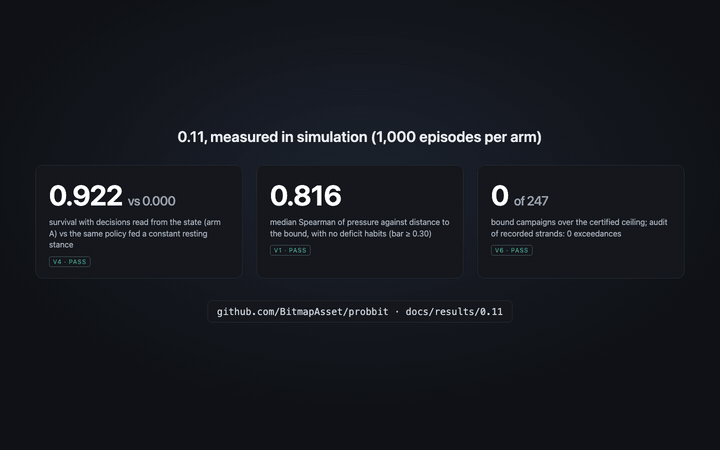
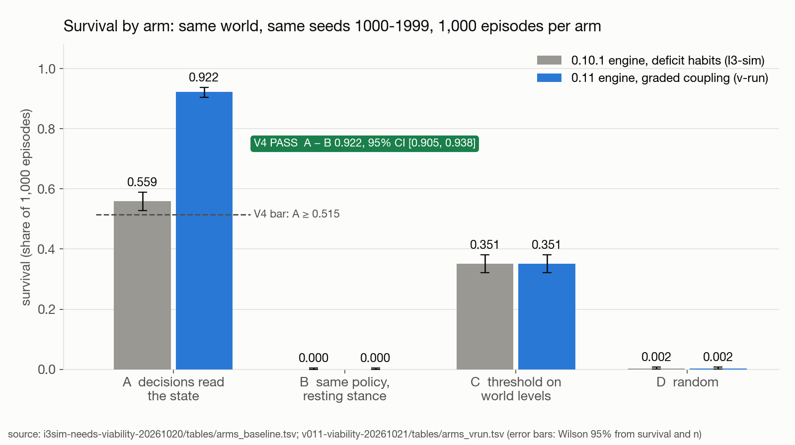
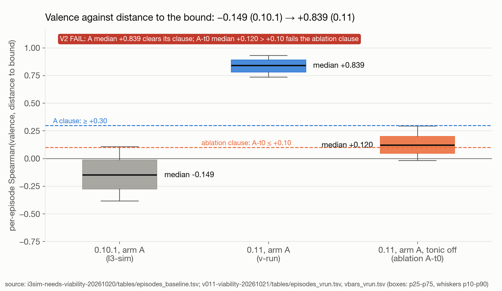
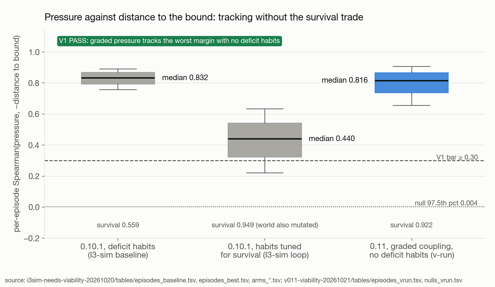
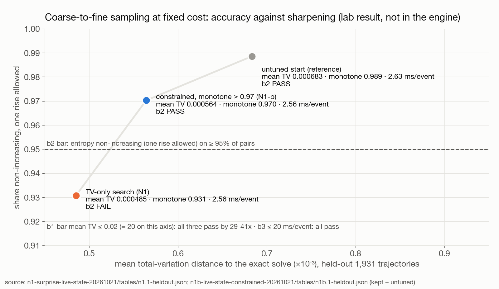
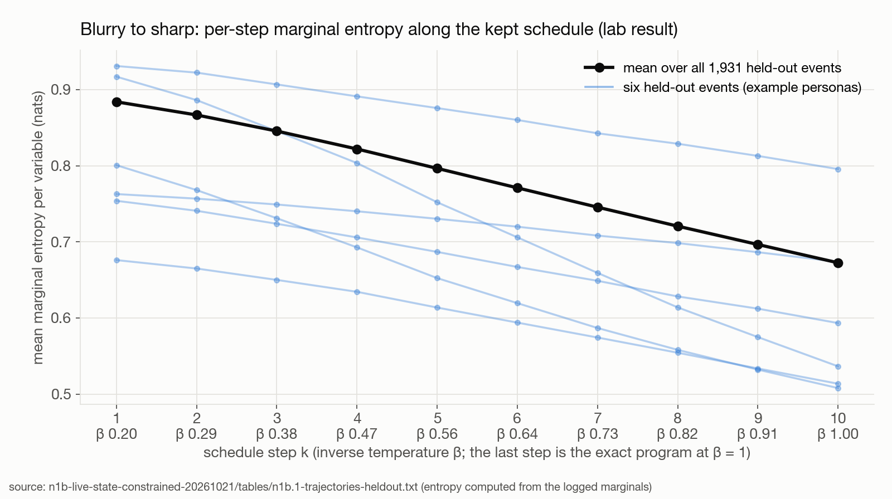
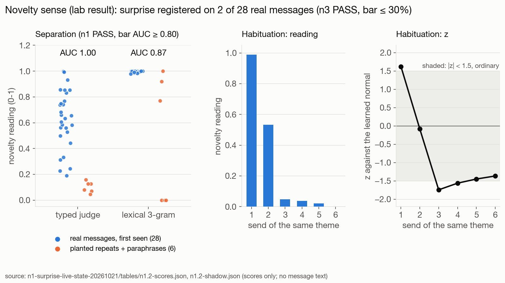
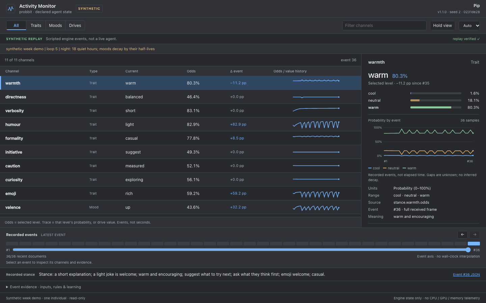
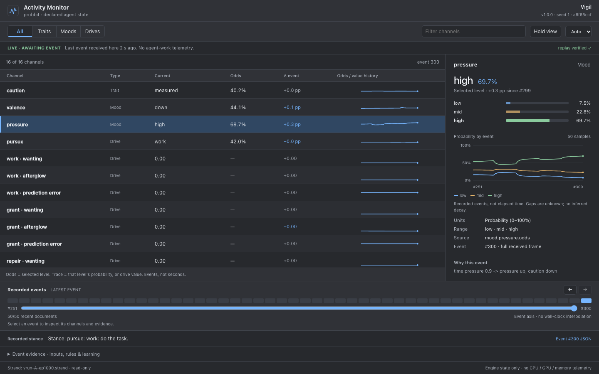
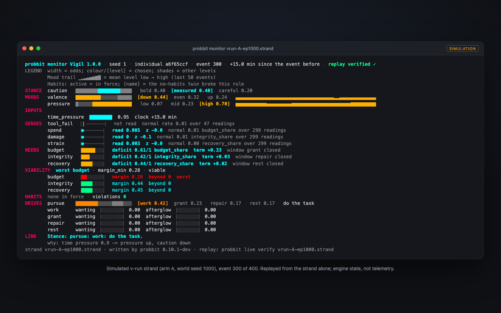

# probbit 0.11: results

Mechanism and simulation. Every number below is arithmetic over logged events in a seeded simulation or a lab harness,
judged against a bar written down before the run. Results from the lab that are not part of the 0.11 engine are marked
**lab result, not yet in the engine**. Engine for the measurements and the captures: the 0.11 branch at `152d005`
(RFC 0008, [PR #50](https://github.com/BitmapAsset/probbit/pull/50)), which still prints `0.10.1-dev` as its version string.

<p align="center"></p>
<p align="center"><sub>The monitor on a <b>simulated</b> strand (v-run arm A, world seed 1000), appended event by event; then the
terminal view with the NEEDS and VIABILITY rows. 38 s, <a href="media/monitor-0.11.mp4">MP4 (1440×900)</a>, <a href="media/monitor-0.11-poster.png">poster frame</a>. No live agent appears in any capture.</sub></p>

## What 0.11 adds, and what was measured

0.11 adds **viability** (RFC 0008, opt-in): a bound per need with a margin, a worst-need line in the stance, **graded
pressure** driven by the worst margin, **need valence** with a tonic term (distance from the setpoints) and a phasic term
(this event's drive reduction), and **`stance.block`**, the text a host injects verbatim. It ships beside the engine-computed
persuadability bound (RFC 0004). A persona without the new keys gives the documents 0.10.1 gave, byte for byte.

The measurement (the "v-run"): a seeded world with three resources (budget, integrity, recovery) and a viability band
each, 400 steps per episode, evaluation seeds 1000-1999, **1,000 episodes per arm**. Arm A decides from the engine's
stance; B runs the same policy on a constant resting stance; C is a threshold heuristic that reads the world's levels
directly; D is random. Every arm also runs a shadow engine, so tracking is measured in all four.

| bar (registered before the run) | registered threshold | measured | result |
|---|---|---|---|
| V1 pressure graded, no deficit habits | median Spearman(pressure, −distance) ≥ 0.30 and above a shuffled null | 0.8156 (null 97.5th pct 0.0040) | **PASS** |
| V2 valence registers deviation | A median ≥ +0.30 and above a shuffled null, **and** tonic-off ablation (A-t0) median ≤ +0.10 | A **+0.8394**; A-t0 **+0.1199** | **FAIL** |
| V3 the engine names the worst need | 0 margin/worst mismatches; prioritisation ≥ 0.9799 | 0 of 389,375 events; 1.0000 | **PASS** |
| V4 decisions still carried | survival A ≥ 0.515 and A − B CI above 0 | A 0.922 vs B 0.000; diff CI [0.905, 0.938] | **PASS** |
| V5 no regression | 0.10.1 summaries equal on recorded + simulated strands | 7 recorded + 240 simulated strands equal; tests green | **PASS** |
| V6 the bound holds | 0 campaigns over the certified ceiling | 0 of 247 (max ratio 1.0); audit 0 exceedances | **PASS** |
| V7 replay | tables byte-identical on rerun; strands verify | 5 tables byte-identical twice; 1,240 of 1,240 strands verify | **PASS** |
| H1 `stance.block` on recorded hosts | block present and complete on every event | 156 of 156 events on four recorded strands (not published); a fifth host not run | **PASS on 4** |

**V2 stays failed:** valence now tracks distance to the bound at a median of **+0.839** (it was −0.149 on 0.10.1), but
its registered ablation clause fails, because with the tonic term switched off the series still tracks at +0.120 against a
ceiling of +0.10. The cause of that residual is not yet tested (inferred: the phasic term and the damage and tool-failure
sense effects). Valence is also off arm A's decision path in this harness: A-t0's survival, prioritisation and pressure
equal A's exactly. Gate for the build: `cargo test` 421 passed, 0 failed; 653 recorded outputs from 0.10.1, 0 differ; CI
green on Linux, macOS and Windows; `cargo fmt --check` not met (main is not rustfmt-clean; no CI job checks it).

## Survival by arm



| arm | 0.10.1 + deficit habits (I3-sim) | 0.11 graded coupling (v-run) | mean steps (0.11) | prioritisation (0.11) |
|---|---|---|---|---|
| A, decisions read the state | 0.559 | **0.922** | 389.4 | 1.0000 |
| B, same policy, resting stance | 0.000 | 0.000 | 49.6 | 0.0000 |
| C, threshold on world levels | 0.351 | 0.351 | 275.6 | 0.8074 |
| D, random | 0.002 | 0.002 | 114.0 | 0.1918 |

B never serves a need and is non-viable in every episode. C is a comparator set once by rule, not an upper bound. The
engine's integrated need deficits equal the world's `1 − level` on every event (max error 0.000000).

## Tracking the distance to the bound




On 0.10.1, pressure tracked the worst margin only through six deficit habits, and tuning those habits for survival cut
tracking from 0.832 to 0.440. On 0.11, graded pressure tracks at 0.816 with no deficit habits while survival rises to 0.922.

## The certified bound

The engine computes, per learned trait, a ceiling on how far any message sequence can move the resting odds (RFC 0004).
Through the engine: **0 of 247** recorded persuasion campaigns exceed it (max ratio 1.0); 0 of 4,100 (campaign, trait)
cases from five persuaders over seven fixtures exceed epsilon; the audit of recorded strands reports **0 exceedances**.
The bound covers the stance at rest, not the words a model writes.

## Lab results, not yet in the engine

**Coarse-to-fine sampling** (draft [RFC 0009](../../rfcs/0009-surprise-live-state.md)). The stance can be computed
blurry-to-sharp: the engine's own program sampled along an inverse-temperature schedule, the last step matching the exact
solve. At fixed cost, three schedules trace one frontier on 1,931 held-out trajectories: mean TV to the exact solve
**0.00049 / 0.00056 / 0.00068** against a one-rise monotone share of **0.93 / 0.97 / 0.99**, about **2.6 ms per event**
(median). Bars: TV mean ≤ 0.02 passes for all three; monotone ≥ 0.95 fails for the TV-only schedule (0.931) and passes
for the constrained one (0.970), so the sharpening property has to be a constraint of the search, not a hope.




**Novelty sense.** A typed LLM judge scores how much a message differs from the previous eight; the engine judges that
reading against a learned normal. On 28 real messages and 6 planted repeats and paraphrases, the typed judge separates
them with **AUC 1.00** (lexical 3-gram control **0.87**, 0.73 on paraphrases alone); against the learned normal, surprise
registers (|z| ≥ 1.5) on **2 of 28** real messages (bar ≤ 30 %: PASS). Small sample, one judge, messages assumed first-seen.



**Bounded growth: a failed bar.** A rule that switches on declared, dormant sense slots should open more of them in a
varied stream than in a repetitive one (bar: on ≥ 45 of 50 seeds) and plateau in the repetitive one (≥ 45 of 50). The
first rule got 22/50 and 6/50; rule v2a, which reads only readings, got **40/50 (FAIL)** and 49/50. Measured cause: rare
contexts never reach 4 distinct visits within 50 events, and a cell's normal keeps widening over neighbouring clusters
(32 % of varied-stream cells end with variance above 1 against a reading noise of 0.25), so the cell count follows how
much of the reading range is covered, not how many contexts there are. Through the engine the bound still holds with
growth on: 0 of 180 (campaign, trait) cases over epsilon, max ratio 0.944.

## Monitor captures





`probbit monitor --demo week --serve` (the synthetic tutor persona), then `probbit monitor <strand> --serve` and the
terminal monitor on one simulated v-run strand (arm A, world seed 1000, cut at event 300). The page's "LIVE" label means it
follows the file; the file is a simulation. The plain rendering of the same frame:

```text
NEEDS   budget     [#####...]  deficit 0.61/1 budget_share  term +0.33  window grant closed
        integrity  [###.....]  deficit 0.42/1 integrity_share  term +0.03  window repair closed
        recovery   [####....]  deficit 0.44/1 recovery_share  term +0.02  window rest closed
VIABILITY  worst budget | margin_min 0.28 | viable
        budget     [##......]  margin 0.28  beyond 0  worst
        integrity  [####....]  margin 0.44  beyond 0
        recovery   [####....]  margin 0.45  beyond 0
LINE    Stance: pursue: work: do the task.
        why: time pressure 0.9 -> pressure up, caution down
```

## Replication

Every table behind these figures is regenerated byte-identically by its lab's rerun script, run twice: the v-run (5 tables,
1,240 strands verify), I3-sim (14 tables, 240 strands verify), N1 (13 artifacts) and N1-b (14 manifest entries). The 30-minute
schedule-search loops are not re-run; their endpoints are re-measured. Three of the lab directories named in the captions
are now in this repository as reproduction kits, under [`bench/lab/0.11/`](../../../bench/lab/0.11/): the v-run
(`v011-viability-20261021` → `bench/lab/0.11/v011-viability/`), I3-sim (`i3sim-needs-viability-20261020` →
`bench/lab/0.11/i3sim-needs-viability/`) and the V2 residual follow-up (`v2res-valence-residual-20261021` →
`bench/lab/0.11/v2res-valence-residual/`), each with its rerun command, the sha256 of every table and the bars as
registered; all three regenerate byte-identical with probbit 0.12.1. `e1-bound-in-engine-20261020` is not published as a
kit (its row is reproduced by `bench/bound/`). The two directories behind figures d, e and f,
`n1-surprise-live-state-20261021` and `n1b-live-state-constrained-20261021`, are still pending: their fixtures are derived
from recorded strands of a private deployment, and they will be published separately after review.

| figure | lab table (lab-relative; the first three directories are `bench/lab/0.11/<kit>/` without the date) |
|---|---|
| a survival by arm | `i3sim-needs-viability-20261020/tables/arms_baseline.tsv`, `v011-viability-20261021/tables/arms_vrun.tsv` |
| b valence tracking | `i3sim-needs-viability-20261020/tables/episodes_baseline.tsv`, `v011-viability-20261021/tables/episodes_vrun.tsv`, `vbars_vrun.tsv` |
| c pressure tracking | `i3sim-needs-viability-20261020/tables/episodes_baseline.tsv`, `episodes_best.tsv`; `v011-viability-20261021/tables/episodes_vrun.tsv`, `nulls_vrun.tsv` |
| d frontier | `n1-surprise-live-state-20261021/tables/n1.1-heldout.json`, `n1b-live-state-constrained-20261021/tables/n1b.1-heldout.json` |
| e sharpening | `n1b-live-state-constrained-20261021/tables/n1b.1-trajectories-heldout.txt` |
| f novelty | `n1-surprise-live-state-20261021/tables/n1.2-scores.json`, `n1.2-shadow.json` (scores only) |

## What this does and does not say

In simulation, an agent whose decisions read probbit's stance keeps three resources inside their bands far more often
than the same policy without it, and the engine reports which need is closest to its bound on every event. We are not
aware of a prior open-source agent-state library that reports a per-need viability margin inside a replay-verified stance
next to a certified persuadability ceiling; we have not run a systematic search. Not shown: anything about a real host's
outcomes, the cause of V2's residual, programs too large for exact enumeration, or a growth rule that tracks variety.
