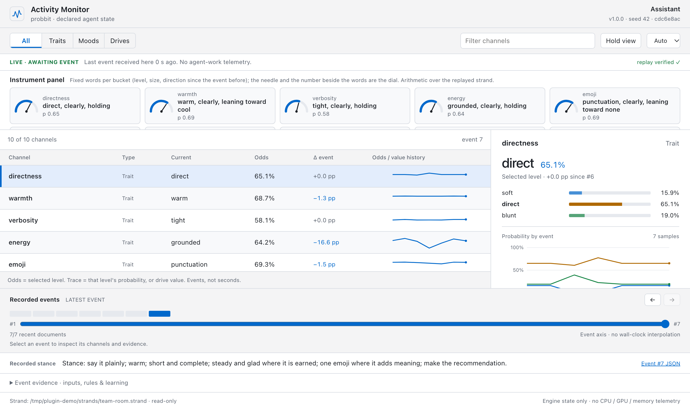

# probbit-stance: an OpenClaw plugin

A [probbit](https://github.com/BitmapAsset/probbit) individual beside your OpenClaw agent. In the sessions you list, every
user message becomes one engine event: the plugin reads the message into the persona's flags, runs `probbit live`, and
puts the resulting stance block into the turn. The model writes every word; the stance says how. Every event is appended
to a strand that `probbit live verify` replays byte for byte, and `probbit monitor` shows the individual's inner state as
it changes.



*The monitor page (`probbit monitor <strand> --open`) on a strand written by this plugin: each trait's levels with their
exact odds, the moods, the inputs the event carried, the habits in force and the ones binding the stance, and the stance
line the model was given.*

## What the model sees

```
## Assistant stance (probbit, event 14)
Stance: security means careful, no play; take the correction straight; say it plainly; short and complete; no emoji.
mood: valence even, pressure keyed. habits bound: security_careful, correction_direct.
Mood glyph: 🔒 (valence even 0.64, pressure keyed 0.58). Use at most one mood emoji in this reply and make it this one.
Write from this stance. End the visible reply with one line: "Assistant 🔒 stance #14 · valence even · pressure keyed · security means careful, no play · in: +2 · moved: pressure, +1".
```

That block is what `probbit-stance` 0.2.0 writes (the `Mood glyph:` line: see "The glyph" below). `probbit-stance`
0.1.0 wrote it without the `Mood glyph:` line and ended with `"Assistant stance #14 · valence even · pressure keyed ·
security means careful, no play · in: correction, security · moved: pressure, caution"`.

The footer is optional (`footer: false` removes it). With it on, the agent's visible reply ends with a line that says
which event this was, the two moods, a few words of the stance, the inputs the plugin fed the engine (`in:`) and the moods
and traits whose level changed since the previous event (`moved:`), 120 characters at most. People in the chat can see
the state move; the strand proves it did.

**The glyph** (`probbit-stance` 0.2.0 with probbit 0.13.0; `probbit-stance` 0.1.0 and probbit 0.12.1 have none). With a
persona that has `display.glyphs` (the bundled one does; [docs/persona.md](../../docs/persona.md)
§2.18), the engine computes one emoji from the stance: the glyph of a habit in force first, else the valence x pressure
table, then 👀 when the expectation block reports a surprise. The footer opens with it (`Assistant 🙂 stance #14 · …`, or `◆🙂 stance
#14 · …` with a symbol prefix), and the block gives the model one more line, `Mood glyph: 🙂 (valence even 0.71, pressure
steady 0.80). Use at most one mood emoji in this reply and make it this one.`, so the reply's mood emoji is the engine's
reading rather than the model's guess. With the surprise modifier the line names the base glyph and reports the modifier
apart (`Mood glyph: 🙂 (…); surprise registered this turn (z 2.3), shown as 👀 in the footer. Use at most one mood emoji in
this reply and make it 🙂.`), and the footer keeps `🙂👀`. `glyphInReply: false` drops that line and keeps the glyph in the
footer. The strand
logs the glyph on every event line and `probbit live verify` recomputes it.

## How it decides what to feed the engine

Each user message is read into the persona's flags: `praise`, `correction`, `failure`, `owner_upset`, `security`.
Explicit markers win outright (`[praise] [correction] [failure] [upset] [security]` anywhere in the message); otherwise
the agent's decision model answers four Boolean questions when one is configured (`agents.defaults.decisionModel`), or
the Jev adapter does (`classifier: jev`, OpenRouter, shadow by default: logged beside the keyword result and not fed to the
engine until you turn `classifierShadow` off); otherwise a conservative keyword list (a correction outranks a "thanks").
The method lands in the log line of every event. Flags the persona does not declare are dropped with one warning each;
`time_pressure` is fed when the classifier scores it (the urgency question, asked by the Jev adapter in live mode). With
`sensesMode` set (since 0.2.0), the plugin also measures readings of its own (next section).

## Senses: tempo, tool failures and time pressure (`sensesMode`)

Since 0.2.0 (not in 0.1.0). A persona can declare senses (docs/persona.md §2.11): readings the host measures,
which the engine judges against a learned normal. The plugin measures three things per event and, depending on
`sensesMode`, sends them or only logs them:

| `sensesMode` | what happens |
|---|---|
| `off` (default) | nothing is measured; the event line, the strand and the hooks are exactly as before |
| `shadow` | the readings are measured and written to `strands/<lane>.senses.jsonl`, one JSON line per event; nothing reaches the engine, so the strand stays byte-identical to `off` (the example entry in `install/` uses this) |
| `feed` | the readings the persona declares are sent with the event: `tempo` and `tool_fail` as sense readings with source `env:probbit-stance`, `time_pressure` as the input when `timePressureSource` is `heuristic`; the strand records them as used |

A sense is fed only when the persona declares it with the right kind and `env` in its `src`: `tempo` as a `number`,
`tool_fail` as a `flag`. Otherwise it is logged and not sent, with one warning per sense in `feed` mode. A persona without
a `senses:` block (the bundled one) gets the same event lines in `feed` as in `off`, except for a heuristic
`time_pressure`. The engine refuses a reading outside a sense's `range` rather than clipping it, so the plugin sends a
tempo above the range's top as the top; the senses line keeps the measured count.

**`tempo`: events in the last 60 minutes, this one included.** It is computed from the strand alone, so a replay
recomputes it: with u_k = round(1e6 × `elapsed_hours`) of event k (whole micro-hours; the strand stamps `elapsed_hours`
to 1e-6 h, so the sums are exact), tempo at event n = #{m ≤ n : u_(m+1) + … + u_n ≤ 1 000 000}. A message exactly 60
minutes after the previous one still counts it; one micro-hour later does not. The plugin reads the strand's last
512 KiB (about 1000 events) for this.

**`tool_fail`: a tool call failed since the previous event.** The `after_tool_call` hook (registered only with
`sensesMode` shadow or feed; observe-only, it never changes a result) counts tool calls in the lane and the ones that
report an `error`. The reading at event n is true when a call made since event n−1 failed. The turn that answers a
message runs after that message's event, so a failure while answering message n−1 shows up at event n. Only calls from
runs that produced an event are counted (a cron or heartbeat run in the same session is not); a call without a run id
is. A tool that returns a failure inside its result instead of an `error` (a shell command with a non-zero exit, say)
is not counted. The counts live in the plugin's memory, so a gateway restart between a failure and the next message
loses them.

**`time_pressure` (`timePressureSource`).** `question` (default): only the urgency question's answer, as before.
`heuristic`: the question's answer when it gives one, otherwise a fixed mapping from the message text (fed only in
`feed` mode). `off`: never. The heuristic is a mechanism over surface features, not a judgement of the person writing:

| feature | adds |
|---|---|
| a strong deadline term: asap, urgent(ly), immediately, right now / right away, hurry, deadline, eod, by tonight / today / tomorrow / noon / midnight / a clock time, in N minutes / hours, before the launch / demo / call / meeting / deploy / release | 0.4 |
| otherwise a soft one: quick(ly), soon, fast, today, tonight, now | 0.2 |
| the first word (after an optional "please") is one of: add, build, cancel, check, delete, deploy, do, finish, fix, kill, make, merge, move, push, remove, restart, revert, rollback, roll, rotate, run, send, ship, start, stop, update, write | 0.2 |
| a "!" or a fully capitalised word of 3+ letters | 0.1 |
| at most 8 words, when another feature fired | 0.1 |

The sum is clipped to [0, 1] and rounded to 2 decimals; the highest possible value is 0.8, a plain message reads 0, and
values below 0.05 are not fed (as with the question). Examples: "fix the build" 0.3, "please ship it today" 0.5,
"restart the gateway right now!" 0.8, "can you take a look at the logs when you get a chance?" 0.

**The senses line** (`strands/<lane>.senses.jsonl`, shadow and feed): `n` (the strand's event number), `ts`, `mode`,
`tempo` and `tempo_src` (`strand`), `time_pressure` and `time_pressure_src` (`question`, `heuristic` or `none`: the value
the configured source picks, fed or not), `time_pressure_heuristic` and `time_pressure_features` (always, for comparison),
`tool_fail`, `tool_fail_src` (`after_tool_call`), `tool_calls`, `tool_errors`, `declared` (the readings this persona
would take) and `fed` (what this event sent beyond the flags and the question's `time_pressure`; always empty in
shadow). A run that fails writes no line, and its tool counts carry over to the next event.

The engine does the rest: the persona's priors and couplings, the moods decaying over the hours between messages, the
habits that bind the stance (hard rules: `security` always makes caution `careful`), and the bounded learning from praise
and corrections, within a cap that keeps the individual itself.

## Install

Requirements: OpenClaw 2026.9.7 or later, probbit 0.13.0 or later on the gateway's PATH (`npm i -g probbit`, or
[one curl line](https://github.com/BitmapAsset/probbit#install)), Node 22+. `probbit-stance` 0.2.0 checks the binary's
version at load: an older probbit gets one warning naming both versions (`probbit-stance 0.2.0 needs probbit 0.13.0 or
later; probbit is probbit 0.12.1: ...`), each lane's first turn logs one more (`lane <lane>: no stance this turn (...)`,
the same reason), and no event runs until it is upgraded. With probbit 0.12.x keep
`probbit-stance` 0.1.0.

1. Back up your config: `cp ~/.openclaw/openclaw.json ~/.openclaw/openclaw.json.pre-probbit-stance`.
2. Install the plugin:
   ```sh
   openclaw plugins install npm:probbit-stance --accept-capabilities
   ```
   The flag is the host's consent step for a plugin that registers hooks (without it the install stops and asks for it).
   The host also asks you to confirm a source outside ClawHub (npm): answer yes, or add `--force` in a script.
   From a clone instead: `cd plugins/openclaw && npm ci && npm run build && openclaw plugins install --link "$PWD" --force --accept-capabilities`.
   A clone of `main` may be ahead of the npm package: pair it with a probbit built from the same clone.
   The install writes `plugins.entries.probbit-stance.enabled: true` and nothing else; with no `lanes` configured the
   plugin registers no hooks and logs one warning, so it is inert until step 3.
3. Tell it which sessions get a stance. Merge into `plugins.entries` of `~/.openclaw/openclaw.json`
   (the full example is `install/openclaw-entries.json`; `hooks` sits next to `config`, not inside it). That example
   sets `"sensesMode": "shadow"`, a key of `probbit-stance` 0.2.0: with 0.1.0 leave that line out, or `openclaw config
   validate` reports `must not have additional properties: "sensesMode"`:
   ```json
   "probbit-stance": {
     "enabled": true,
     "hooks": { "allowConversationAccess": true },
     "config": {
       "lanes": {
         "agent:main:telegram:group:-1001234567890": "team-room",
         "agent:main:telegram:direct:*": "dm"
       }
     }
   }
   ```
   A lane is a name for one individual's life; a session key maps to it exactly, or by a prefix ending in `*`
   (`openclaw sessions list` shows the keys). Everything else has a default: the bundled persona
   (`personas/assistant.yaml`), state under `~/.openclaw/probbit-stance/`, `probbit` on PATH, a 500 ms budget per turn,
   the footer on, the shadow gate on.
4. Restart the gateway (a hot reload of a new plugin can leave live sessions wedged; the restart is the sure path).
5. Verify:
   - `openclaw plugins inspect probbit-stance --runtime --json` lists both hooks, nothing blocked.
   - One message in a listed session: the reply ends with `Assistant stance #1 · …`, and
     `~/.openclaw/probbit-stance/strands/<lane>.strand` has a header line and one event line.
   - `probbit live verify ~/.openclaw/probbit-stance/strands/<lane>.strand` prints `"ok": true`.
   - The gateway log has no `[probbit-stance]` warning for that turn.

Watch it: `probbit monitor ~/.openclaw/probbit-stance/strands/<lane>.strand --open` (a page on 127.0.0.1 that follows
the strand), or `--follow` in a terminal.

## Your own persona

Copy `personas/assistant.yaml` (its `display` block needs probbit 0.13.0), rename the identity, change the priors, the `say` words and the habits
([docs/persona.md](../../docs/persona.md) is the reference; `probbit persona prove` and `probbit check` test a persona's
rules before you ship it), and set `personaPath`. Keep the input ids the plugin sets (`praise`, `correction`, `failure`,
`owner_upset`, `security`) if you want those readings; drop any you do not want and the plugin skips them with a warning.

## Rollback

- Kill switch, no restart: set `plugins.entries.probbit-stance.enabled` to `false`.
- Full: remove the entry, `openclaw plugins uninstall probbit-stance`, restart. The lane files stay (the life is
  append-only); delete `~/.openclaw/probbit-stance/` if you want them gone.

## Config

| key | default | meaning |
|---|---|---|
| `lanes` | `{}` | exact session key, or prefix ending in `*`, → lane name (`[a-z0-9][a-z0-9._-]*`). Only these sessions are hooked. |
| `personaPath` | bundled `personas/assistant.yaml` | persona for `probbit live` / `persona init` |
| `stateDir` | `~/.openclaw/probbit-stance` | `state/`, `strands/`, `last/`, `log/`, one file per lane |
| `binary` | `probbit` | the probbit binary (0.13.0 or later, checked at load); a path or a name on PATH |
| `seed` | `42` | seed for `persona init` when a lane has neither state nor strand |
| `timeoutMs` | `500` | the hook's wait for probbit; a late run still finishes and logs `"late": true` |
| `gateMode` | `shadow` | `shadow` logs would-deny lines for destructive tool calls under a careful stance; `off` registers no tool hook |
| `footer` | `true` | ask for the footer line |
| `footerPrefix` | the persona's name | opens the footer line (an emoji or a short handle works; 24 characters at most) |
| `glyphInReply` | `true` | since 0.2.0; with a persona that has `display.glyphs`: the block's `Mood glyph:` line (the footer shows the glyph either way) |
| `inject` | `appendContext` | `appendSystemContext` puts the block in the system prompt instead (changes the cached prefix every turn) |
| `classifier` | `auto` | `auto`: the agent's decision model when configured, else keywords; `jev`: the Jev adapter; `keyword` |
| `classifierShadow` | `true` | with `jev`: log Jev's answers, feed the engine the keyword flags |
| `classifierTimeoutMs` | `300` (`800` with jev) | classifier budget per turn |
| `decisionThreshold` | `0.6` | accept a Boolean answer at p ≥ this |
| `jevModel` | `typesafe/jev-1.13` | pinned Jev model id |
| `jevKeyFile` | `~/.openclaw/probbit-stance/openrouter.env` | env-style file with `OPENROUTER_API_KEY`; read once at start, never logged |
| `senderIds` | `[]` | when set, only these sender ids produce events (other group members are skipped) |
| `sensesMode` | `off` | since 0.2.0: `shadow` measures tempo, tool_fail and the heuristic time_pressure and logs them to `strands/<lane>.senses.jsonl`; `feed` also sends the ones the persona declares ([Senses](#senses-tempo-tool-failures-and-time-pressure-sensesmode)) |
| `timePressureSource` | `question` | since 0.2.0: `question` (the urgency question only), `heuristic` (the question, else the text heuristic; fed with `sensesMode` feed), `off` |
| `agentName` | the session key's agent id | since 0.2.0: the `agent` label of every lane ([Labels](#labels-for-the-monitor-labels-agentname)) |
| `labels` | `{}` | since 0.2.0: labels for every lane's sidecar; free keys are added, and `agent`, `host`, `lane` or `session` here override the computed value |
| `destructive` | built-in list | `{id, tools, regex, param?}` or `{id, tools, pathPrefix}`; replaces the defaults |

Default destructive list (shadow gate): `rm -rf`, `git push --force`, `curl | sh`, `openclaw config set/unset`, shell or
file-tool writes to `~/.openclaw/openclaw.json`. The gate never blocks; it writes one JSON line per would-deny to
`log/<lane>-gate.jsonl` with the rule, the tool, the stance that would have denied it, and a digest plus a redacted
160-character preview of the detail (the raw command or path is never written in clear).

## Labels for the monitor (`labels`, `agentName`)

Since 0.2.0 (not in 0.1.0). Beside each lane's strand the plugin keeps `strands/<lane>.labels.json`, the
sidecar `probbit monitor` reads to say who wrote the strand ([docs/agents.md](../../docs/agents.md), "How a host
identifies itself"). Per lane it computes:

| key | value |
|---|---|
| `host` | `OpenClaw <version>` from the plugin runtime (`OpenClaw` when the runtime gives no version) |
| `lane` | the lane name |
| `agent` | `agentName` when set, else the agent id of the session key (`agent:<agentId>:...`) |
| `session` | the channel and kind of the session key plus the first 8 hex of its sha256, e.g. `telegram group #3fa9c2d1`; `#3fa9c2d1` for other shapes. Never the session key, a chat id or a user id |

The `labels` config key adds free keys (at most 4, so a lane stays within the sidecar's 8) and **overrides** the computed
ones: `"labels": {"host": "gateway A", "team": "support"}` writes `host` = `gateway A`, your word over the plugin's.
Keys are 1-64 of `A-Z a-z 0-9 _ . -`, values 1-64 characters without control characters; an invalid entry is dropped
with one warning at start and the rest of the config still loads.

When a lane's first event creates its strand and the binary's `probbit live --help` lists `--label` (asked once per
process), the labels go to that `probbit live` call as `--label k=v` and the CLI writes the sidecar. Otherwise, and on
every later event, the plugin writes the sidecar itself when it is missing or differs from its current keys merged with
the lane's labels: keys you added by hand stay, the computed and configured ones are put back, and an equal file is not
rewritten. The write is atomic and never touches the strand. A lane shared by several sessions (a `prefix*` entry)
shows the session of its latest event. A sidecar that is not a flat JSON object of strings, or a merge past 8 keys, is
left as is with one warning per lane.

## Logs and receipts

- `strands/<lane>.strand`: the life. Header (persona document, initial state, engine), then one line per event with the
  inputs as used and the chained digests. `probbit live verify` replays it; `python3 python/probbit_host.py receipts`
  (in the probbit repo) renders one record per decision ([docs/receipts.md](../../docs/receipts.md)).
- `strands/<lane>.labels.json` (since 0.2.0): the lane's labels for `probbit monitor` (above).
- `log/<lane>.jsonl`: `iso \t event \t stance-document \t meta`, where meta holds the event number, the idempotency key,
  the classification method and flags, the text source, the milliseconds, and (with jev) the classifier's answers.
- `last/<lane>.ts`: the epoch of the previous event, for the hours the engine decays moods over.
- `strands/<lane>.senses.jsonl` (`sensesMode` shadow or feed; since 0.2.0): one line per event with the
  readings the plugin measured, the source of each and what it fed.

## Safety properties

- Only the listed sessions are touched. Heartbeats, cron runs and inter-session messages never produce events.
- One event per admitted user message (the native message id when the host gives one; a retry reuses the event).
- Any failure (no binary, a probbit older than 0.13.0, bad persona, timeout) means no injection and one warning; the hooks never throw into the host,
  and the tool hooks never block (`after_tool_call`, since 0.2.0 and registered only with `sensesMode`, only counts).
- The strand is append-only and never rewritten. The plugin serialises its own events per lane; do not write the same
  strand from another process.

## Develop

```sh
npm ci && npm test                 # tsc against the bundled SDK type slice (types/) + node:test with the real binary (PROBBIT_BIN or PATH)
ln -s /opt/homebrew/lib/node_modules/openclaw node_modules/openclaw && npm run test:host   # the same against an installed OpenClaw's real types
npm run check:host                 # read-only: the installed host's manifest loader and config-schema validator on this package
```

The built entry (`dist/src/*.js`) imports nothing from `openclaw` at runtime (type-only imports), so an installed copy
needs no `node_modules`. `openclaw plugins validate` targets tool plugins (it looks for tool-authoring metadata) and
reports this hooks-only plugin as not valid; `npm run check:host` is the check that applies (the host's manifest loader
accepts the manifest, the config schema accepts the example entry and rejects a bad one). Checked here: the hook contract end to end against a mocked host built from the 2026.9.7 SDK
types, with the real binary; the author runs the same code live on his own agent.
